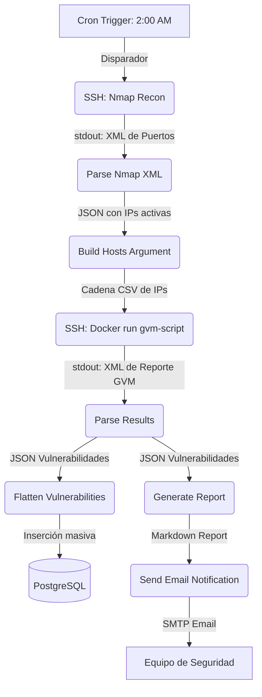

# Informe Técnico: Automatización de Escaneo de Vulnerabilidades con n8n y OpenVAS

**Autor:** Grupo TASTSERV 
**Fecha:** 1 de Julio de 2026  
**Proyecto:** Pipeline de Escaneo Activo de Red y Gestión de Vulnerabilidades  

---

## 1. Resumen Ejecutivo del Proyecto

Este proyecto implementa una infraestructura automatizada de ciberseguridad para la detección proactiva de dispositivos expuestos y la evaluación periódica de sus vulnerabilidades. 

A través del orquestador **n8n**, se coordina un flujo continuo que:
1. Despierta de manera diaria en horas de baja actividad (2:00 AM).
2. Realiza un reconocimiento de activos (Host Discovery) en el segmento de red asignado usando **Nmap**.
3. Inicia de manera dinámica una tarea de escaneo profundo en la suite de **OpenVAS (Greenbone Community Edition)** utilizando su API (GMP - Greenbone Management Protocol) sobre sockets locales.
4. Parsea y extrae los resultados XML nativos del escaneo, aplanándolos y transformándolos a formato relacional.
5. Registra de forma histórica los hallazgos en una base de datos **PostgreSQL**.
6. Genera un reporte detallado en formato Markdown estructurado para análisis rápido y lo envía mediante **SMTP (Correo electrónico)** al área correspondiente.

---

## 2. Arquitectura de Integración y Flujo de Datos

El flujo lógico del pipeline de n8n coordina varios microservicios y comandos de sistema. A continuación se presenta el flujo detallado:



---

## 3. Pila Tecnológica y Herramientas (Stack)

*   **Orquestador de Procesos:** [n8n](https://n8n.io) (ejecutándose en Docker en el puerto `5678` con persistencia de volúmenes en `~/.n8n`).
*   **Reconocimiento de Red:** **Nmap** (Network Mapper) ejecutando detección de servicios y scripts por defecto en la red objetivo.
*   **Motor de Escaneo de Vulnerabilidades:** **Greenbone Community Edition (OpenVAS)** en su versión para contenedores Docker (coordinando servicios como `gvmd`, `ospd-openvas`, `openvas-scanner` y `redis`).
*   **Interfaz/API de GVM:** `gvm-tools` utilizando scripts GMP en Python (`automated_scan.gmp.py`) y llamadas nativas por sockets Unix.
*   **Base de Datos:** **PostgreSQL** para la persistencia del histórico de escaneos y generación posterior de tableros de control (Dashboarding).
*   **Notificación:** Servidor de correo **SMTP** compatible.
*   **Contenedores y Entornos:** **Docker & Docker Compose** para garantizar el aislamiento y la fácil reproducibilidad de todos los servicios.

---

## 4. Análisis Detallado de Cada Nodo de n8n

El flujo de trabajo se compone de 10 nodos específicos, descritos detalladamente a continuación en base a su funcionamiento físico, lógico e integraciones:

---

### Nodo 1: Cron Trigger - 2AM Diario
*   **Tipo de Nodo:** `n8n-nodes-base.scheduleTrigger` (Versión 1.2)
*   **¿Para qué sirve?**
    Es el disparador (Trigger) inicial del flujo de trabajo. Garantiza que la auditoría de seguridad se ejecute de forma periódica y automatizada sin intervención humana, idealmente en una ventana horaria en la que no se afecte el ancho de banda del laboratorio o producción.
*   **¿Cómo funciona?**
    Se configura mediante una expresión del planificador de tareas (Cron Expression) parametrizada en `"0 2 * * *"`, lo cual se traduce en "ejecutar a las 02:00 AM todos los días de la semana, todos los meses".
*   **¿Por qué funciona?**
    El núcleo (core) de n8n incluye un planificador de tareas basado en la librería de Node.js `cron`. Este scheduler corre en segundo plano dentro del contenedor de n8n. Al coincidir la hora del sistema con el patrón cron, el motor de eventos de n8n instancia una ejecución de este flujo y le pasa el contexto inicial.

---

### Nodo 2: Execute a command (SSH)
*   **Tipo de Nodo:** `n8n-nodes-base.ssh` (Versión 1)
*   **¿Para qué sirve?**
    Ejecuta un comando remoto a través de una consola segura (SSH) para realizar un escaneo activo de red rápido usando Nmap. Su objetivo es detectar qué equipos están vivos y qué puertos tienen abiertos antes de lanzar un escaneo pesado de vulnerabilidades.
*   **¿Cómo funciona?**
    Se conecta mediante credenciales SSH del host (`sshPassword`) y ejecuta la siguiente línea de bash:
    ```bash
    TS=$(date +%Y%m%d_%H%M%S) && nmap -sV -sC -oX /tmp/nmap_scan_${TS}.xml 192.168.100.0/24 && cat /tmp/nmap_scan_${TS}.xml && rm -f /tmp/nmap_scan_${TS}.xml
    ```
    1. Define una estampa de tiempo (`TS`).
    2. Ejecuta `nmap` escaneando el rango `192.168.100.0/24`. Las banderas `-sV` (determinar versión del servicio) y `-sC` (ejecutar scripts básicos de diagnóstico) aseguran una recolección rica de información.
    3. Guarda la salida estructurada en XML (`-oX`) dentro de `/tmp/`.
    4. Imprime el contenido (`cat`) del archivo para que n8n lo capture en su flujo de datos.
    5. Limpia el sistema de archivos borrando el XML temporal (`rm`).
*   **¿Por qué funciona?**
    El nodo SSH de n8n actúa como un cliente SSH nativo de Node.js (usualmente basado en `ssh2`). Este establece un túnel TCP cifrado hacia el servidor objetivo, autenticándose con clave o contraseña. Al ejecutar el comando, n8n captura los canales estándar `stdout` (salida estándar) y `stderr` (salida de error). Si el comando finaliza con código de salida `0`, n8n toma todo el `stdout` (el archivo XML impreso) y lo coloca en un objeto JSON (`stdout`) para los nodos siguientes.

---

### Nodo 3: Parse Nmap XML
*   **Tipo de Nodo:** `n8n-nodes-base.code` (Versión 2)
*   **¿Para qué sirve?**
    Transforma la cadena de texto XML plano generada por Nmap en un arreglo de objetos JSON estructurados y fáciles de procesar en fases posteriores de programación o base de datos.
*   **¿Cómo funciona?**
    Ejecuta código JavaScript personalizado que procesa la variable del nodo anterior:
    ```javascript
    const xmlData = $input.first().json.stdout;
    // Extrae bloques <host> mediante expresiones regulares
    const hostBlocks = xmlData.match(/<host[^>]*>[\s\S]*?<\/host>/g) || [];
    ```
    Por cada host, extrae la IP, hostname, estado físico (`up/down`), sistema operativo (`osmatch`) y un mapeo detallado de puertos abiertos (puerto, protocolo, estado, nombre de servicio y versión detectada).
*   **¿Por qué funciona?**
    El nodo `Code` corre bajo un motor sandbox seguro de Javascript de n8n. Al utilizar expresiones regulares (`regex`) nativas de Javascript, evita tener que cargar costosas dependencias externas de NPM de análisis XML como `xml2js`, garantizando la portabilidad del código entre diferentes versiones e instalaciones de n8n sin requerir la inyección manual de librerías en la imagen del contenedor.

---

### Nodo 4: Build Hosts Argument
*   **Tipo de Nodo:** `n8n-nodes-base.code` (Versión 2)
*   **¿Para qué sirve?**
    Consolida las direcciones IP descubiertas en el paso de Nmap y las agrupa en una única variable compacta.
*   **¿Cómo funciona?**
    Itera por los diferentes items JSON emitidos por el parser de Nmap, filtra únicamente las IPs válidas y conocidas, y las concatena utilizando una coma como separador:
    ```javascript
    const items = $input.all();
    const ips = items.map(item => item.json.ip).filter(ip => ip && ip !== 'Unknown');
    const hostsArg = ips.join(',');
    return [{ json: { hostsArg } }];
    ```
*   **¿Por qué funciona?**
    En n8n, si un nodo de código produce $N$ elementos de salida, los nodos subsiguientes se ejecutarán $N$ veces consecutivas (iteración uno a uno). Dado que un escaneo de vulnerabilidades profundo de OpenVAS sobre un host puede durar entre 10 y 30 minutos, ejecutar el escaneo secuencialmente $N$ veces colapsaría el servidor. Al formatear los hosts activos en una sola cadena `"192.168.100.10,192.168.100.15..."` y devolver un solo elemento JSON de salida, forzamos a n8n a ejecutar el siguiente nodo de escaneo una única vez para todo el conjunto de hosts en paralelo.

---

### Nodo 5: Run OpenVAS Scan (gvm-script)
*   **Tipo de Nodo:** `n8n-nodes-base.ssh` (Versión 1)
*   **¿Para qué sirve?**
    Inicia y supervisa el escaneo pesado de vulnerabilidades en los equipos activos detectados, aprovechando la infraestructura de contenedores de Greenbone (OpenVAS).
*   **¿Cómo funciona?**
    Se conecta al servidor Docker remoto/local y lanza el contenedor de herramientas GMP pasándole la lista de hosts:
    ```bash
    docker compose -f /home/tizi/docker-compose.yml run -T --rm -v /home/tizi/gvm-scripts:/scripts gvm-tools gvm-script --gmp-username admin --gmp-password 'NuevaPassword123!' socket /scripts/automated_scan.gmp.py "{{$json.hostsArg}}"
    ```
    Este comando ejecuta el script Python `automated_scan.gmp.py` (descrito más adelante), el cual interactúa directamente con el demonio del gestor de vulnerabilidades (GVMD) a través de un socket GMP Unix, crea las tareas de escaneo necesarias, monitorea su progreso y arroja el XML del reporte finalizado a la consola.
*   **¿Por qué funciona?**
    El motor de n8n permite realizar interpolación de variables usando la notación `{{$json.hostsArg}}`, inyectando dinámicamente las IPs calculadas en el comando bash. Como el script de Python implementa un bucle de espera interna (polling), el nodo SSH permanece en espera activa (blocking input) hasta que finalice el escaneo completo (o se alcance el límite de tiempo del comando). Al concluir, n8n captura la salida estándar del reporte XML.

---

### Nodo 6: Parse Results
*   **Tipo de Nodo:** `n8n-nodes-base.code` (Versión 2)
*   **¿Para qué sirve?**
    Extrae, limpia y estructura en formato JSON las vulnerabilidades contenidas en la salida XML del escaneo profundo de OpenVAS.
*   **¿Cómo funciona?**
    Lee el string plano del reporte XML del nodo anterior y busca bloques de coincidencia `<result>` (donde se especifican las vulnerabilidades). Por cada coincidencia, extrae:
    *   Nombre de la vulnerabilidad (`<name>`)
    *   Severidad numérica (`<severity>` de 0.0 a 10.0)
    *   Host y puerto afectado (`<host>`, `<port>`)
    *   Descripción detallada (`<description>`)
    *   Solución o mitigación recomendada (`<solution>`)
    *   CVE asociado (`<cve>`)
    Devuelve un único objeto JSON que contiene un array con todas las vulnerabilidades consolidadas y la estampa de tiempo actual del escaneo (`scanDate`).
*   **¿Por qué funciona?**
    Nuevamente, este nodo utiliza código Javascript aislado para realizar un análisis sintáctico por regex sumamente rápido y resiliente del XML de GVM. Al estructurar los datos en un solo JSON con la firma `{ vulnerabilities: [...], scanDate: '...' }`, permite bifurcar el flujo de n8n hacia dos ramificaciones en paralelo: una para persistencia en base de datos y otra para visualización/alertas por correo.

---

### Nodo 7: Flatten Vulnerabilities
*   **Tipo de Nodo:** `n8n-nodes-base.code` (Versión 2)
*   **¿Para qué sirve?**
    Prepara los datos del reporte agregados para el almacenamiento relacional, dividiendo el array consolidado de vulnerabilidades en múltiples objetos JSON individuales.
*   **¿Cómo funciona?**
    Desanida la estructura JSON agregada mediante una función `.map()`:
    ```javascript
    const data = $input.first().json;
    const vulnerabilities = data.vulnerabilities;
    return vulnerabilities.map(vuln => ({
      json: {
        scan_date: data.scanDate,
        host: vuln.host,
        vulnerability_name: vuln.name,
        // ... (mapeo uno a uno de cada propiedad)
      }
    }));
    ```
*   **¿Por qué funciona?**
    El nodo de inserción en Base de Datos de n8n requiere que cada fila que se desea insertar en la tabla corresponda a un elemento independiente dentro del array de entrada de n8n. Este nodo realiza el desempaquetado ("flattening"), convirtiendo un solo mensaje de entrada en $K$ mensajes independientes de salida, donde $K$ es el número total de vulnerabilidades descubiertas.

---

### Nodo 8: Store in PostgreSQL1
*   **Tipo de Nodo:** `n8n-nodes-base.postgres` (Versión 2.5)
*   **¿Para qué sirve?**
    Guarda de forma permanente y masiva los registros individuales de vulnerabilidades en una base de datos centralizada PostgreSQL para su posterior visualización en paneles de auditoría (por ejemplo, Grafana o Kibana).
*   **¿Cómo funciona?**
    Utiliza una conexión preconfigurada en n8n a la base de datos PostgreSQL. Escribe en la tabla `vulnerability_scans` del esquema `public`. Está configurado bajo el modo `autoMapInputData` (Mapeo Automático de Datos), relacionando automáticamente las claves JSON del nodo de aplanado directamente con las columnas homónimas de la tabla de la base de datos.
*   **¿Por qué funciona?**
    n8n se conecta al motor PostgreSQL usando un controlador cliente nativo TCP. Al procesar los registros en lote (batch inserts), realiza consultas SQL optimizadas reduciendo el overhead de conexiones. Además, maneja automáticamente la conversión de tipos básicos (por ejemplo, convirtiendo el texto de severidad a número de punto flotante en la base de datos).

---

### Nodo 9: Generate Report
*   **Tipo de Nodo:** `n8n-nodes-base.code` (Versión 2)
*   **¿Para qué sirve?**
    Construye un informe analítico ejecutivo con formato visual rico utilizando Markdown. Agrupa las vulnerabilidades por su nivel de criticidad según la escala internacional CVSS.
*   **¿Cómo funciona?**
    El código clasifica las vulnerabilidades en base a su severidad numérica:
    *   **Crítica:** Severidad >= 9.0
    *   **Alta:** Severidad entre 7.0 y 8.9
    *   **Media:** Severidad entre 4.0 y 6.9
    *   **Baja:** Severidad menor a 4.0
    Calcula porcentajes y construye dinámicamente un texto Markdown que contiene:
    1. Un resumen ejecutivo en formato tabla.
    2. Detalle completo de vulnerabilidades Críticas (con sus recomendaciones y CVE).
    3. Detalle resumido de vulnerabilidades Altas (primeros 5 registros).
    4. Detalle de vulnerabilidades Medias.
    5. Detalle de vulnerabilidades Bajas e Informativas.
    6. Conteo estadístico desglosado por cada host analizado.
    7. Recomendaciones generales de saneamiento.
*   **¿Por qué funciona?**
    El nodo ejecuta lógica nativa de agregación y concatenación de Javascript. Se alimenta directamente de los datos agregados generados en el nodo `Parse Results`. Devuelve un objeto JSON con el texto Markdown compilado dentro de la propiedad `report`.

---

### Nodo 10: Send Email Notification
*   **Tipo de Nodo:** `n8n-nodes-base.emailSend` (Versión 2.1)
*   **¿Para qué sirve?**
    Envía de forma proactiva el informe ejecutivo generado al equipo de operaciones y seguridad TI a través de correo electrónico.
*   **¿Cómo funciona?**
    Toma la salida del nodo de reporte e inicializa una transmisión SMTP:
    *   **De:** `from@example.com`
    *   **Para:** `to@example.com`
    *   **Asunto:** Dinámico, interpolando la fecha: `Reporte de Vulnerabilidades - {{new Date($json.scanDate).toLocaleString('es-AR')}}`
    *   **Formato:** Texto plano (adecuado para visualizar la estructura del informe Markdown).
    *   **Cuerpo:** Evaluado con la expresión `{{ $json.report }}`.
*   **¿Por qué funciona?**
    El nodo realiza una conexión SMTP clásica, enviando comandos como `HELO/EHLO`, `MAIL FROM`, `RCPT TO` y `DATA` a través de los servidores configurados en las credenciales SMTP de n8n, enviando de forma segura el informe al destinatario final.

---

## 5. Análisis de los Scripts Auxiliares de Integración

El proyecto se sustenta técnicamente en dos scripts ubicados en el directorio `/home/tizi/gvm-scripts/` que permiten comandar al escáner de OpenVAS a través del protocolo GMP.

### Script A: [automated_scan.gmp.py](file:///home/tizi/gvm-scripts/automated_scan.gmp.py)
Este script en Python utiliza la biblioteca nativa de Greenbone `gvm-tools` para comunicarse a través de un socket GMP Unix:

1.  **Entrada:** Recibe como argumento una lista de hosts o IPs separados por comas (por ejemplo: `sys.argv[1]`).
2.  **Creación del Objetivo (Target):**
    Utiliza el ID de puertos por defecto `33d0cd82-57c6-11e1-8ed1-406186ea4fc5` (que representa la lista de puertos TCP y UDP más comunes en OpenVAS) y llama al método `gmp.create_target` asignándole un nombre dinámico con estampa de tiempo `Auto-Target-<epoch>`.
3.  **Creación de la Tarea (Task):**
    Crea la tarea de escaneo usando el objetivo previo, el ID de escaneo por defecto de tipo "Full and Fast" (`daba56c8-73ec-11df-a475-002264764cea`) y el ID del escáner por defecto (`08b69003-5fc2-4037-a479-93b440211c73`).
4.  **Ejecución e Inicialización:**
    Ejecuta `gmp.start_task(task_id)` y obtiene el `report_id` resultante.
5.  **Bucle de Polling (Espera Activa):**
    Dado que las tareas de GVM corren en segundo plano, el script realiza consultas periódicas de estado mediante `gmp.get_task(task_id)` cada 15 segundos (`poll_interval`). El bucle se rompe únicamente cuando el estado de la tarea pasa a ser `"Done"`, `"Stopped"` o `"Interrupted"`. Tiene un límite de seguridad (timeout) de 30 minutos (1800 segundos).
6.  **Obtención y Salida del Reporte:**
    Llama a `gmp.get_report(report_id, details=True)` para extraer todo el detalle técnico de las vulnerabilidades encontradas y lo imprime a la salida estándar (`stdout`) en formato XML serializado.

### Script B: [automated_scan.sh](file:///home/tizi/gvm-scripts/automated_scan.sh)
Es un script alternativo o envoltura (wrapper) en Bash que cumple la misma función pero prescinde de las dependencias complejas de Python e interactúa directamente usando XML crudo y la utilidad de línea de comandos `gvm-cli`:

*   Construye las llamadas GMP enviando payloads en XML directamente a través del comando `gvm-cli --xml "<xml_payload>" socket`.
*   Realiza análisis básico del XML usando filtros de consola de Linux tradicionales como `grep`, `sed` y `cut` para capturar identificadores clave como `TARGET_ID`, `TASK_ID` y `REPORT_ID`.
*   Implementa una lógica similar de polling para verificar el progreso de la tarea a través de solicitudes periódicas XML (`<get_tasks task_id='...'/>`).

---

## 6. Esquema e Ingesta en PostgreSQL

El nodo de base de datos asume la existencia de la tabla `vulnerability_scans`. El esquema sugerido en PostgreSQL para dar soporte al nodo `Store in PostgreSQL1` con mapeo automático es el siguiente:

```sql
CREATE TABLE public.vulnerability_scans (
    id SERIAL PRIMARY KEY,
    scan_date TIMESTAMP WITH TIME ZONE NOT NULL,
    host VARCHAR(100) NOT NULL,
    vulnerability_name VARCHAR(255) NOT NULL,
    severity NUMERIC(3, 1) NOT NULL,
    port VARCHAR(20),
    cve VARCHAR(50),
    description TEXT,
    solution TEXT
);

-- Índices recomendados para optimización de consultas históricas
CREATE INDEX idx_vuln_scan_date ON public.vulnerability_scans(scan_date);
CREATE INDEX idx_vuln_host ON public.vulnerability_scans(host);
CREATE INDEX idx_vuln_severity ON public.vulnerability_scans(severity);
```

### Flujo de datos a través de la DB:
```
Nmap (Hosts vivos) -> Python/OpenVAS (Vulnerabilidades en XML)
                     |
                     v
             Parseo en Código JS
                     |
                     v
            Aplanado de Objetos
                     |
                     v
          [Inserción en Lote SQL] ---> PostgreSQL [Persistencia Histórica]
```

---

## 7. Infraestructura y Docker Compose

### Servicio de n8n ([docker-compose.yml en n8n-stack](file:///home/tizi/n8n-stack/docker-compose.yml))
La instancia local de n8n corre de forma aislada a través del archivo de configuración `docker-compose.yml` en la carpeta `n8n-stack`:

*   **Imagen base:** `n8nio/n8n`
*   **Puerto expuesto:** `5678` redireccionando al puerto interno del contenedor `5678`.
*   **Persistencia:** Mapea el directorio oculto `~/.n8n` del host hacia `/home/node/.n8n` en el contenedor. Esto asegura que los flujos de trabajo, configuraciones y la base de datos interna SQLite de n8n no se pierdan al reiniciar el contenedor.
*   **Autenticación Básica:** Configurada mediante variables de entorno para proteger la interfaz gráfica del orquestador:
    *   `N8N_BASIC_AUTH_ACTIVE=true`
    *   `N8N_BASIC_AUTH_USER=Tizi`
    *   `N8N_BASIC_AUTH_PASSWORD=<REDACTADO>`

### Suite GVM/OpenVAS ([docker-compose.yml de GVM](file:///home/tizi/docker-compose.yml))
Ejecuta la suite oficial **Greenbone Community Edition** compuesta por más de 15 microservicios coordinados (scanners, bases de datos de firmas de vulnerabilidades, asistentes web y utilidades API). `gvmd` expone un socket Unix (`gvmd.sock`) compartido a través de volúmenes con el servicio `gvm-tools`, permitiendo que los scripts de escaneo automatizados se comuniquen localmente con total velocidad y sin requerir sockets TCP expuestos al exterior.

---

## 8. Conclusiones y Beneficios del Proyecto

1.  **Reducción de Falsos Positivos:** El uso preliminar de Nmap permite escanear únicamente los hosts activos en el momento de la ejecución, previniendo escaneos inútiles a direcciones IP vacías en OpenVAS.
2.  **Persistencia y Auditoría:** Al guardar la información en una base de datos PostgreSQL en lugar de depender únicamente de los reportes en PDF de OpenVAS, se facilita la creación de métricas de evolución temporal de seguridad.
3.  **Alertas Tempranas:** Al clasificar y filtrar las vulnerabilidades críticas y enviarlas por correo de forma inmediata, se acelera el tiempo de remediación frente a incidentes graves de seguridad de la información.
4.  **Bajo Acoplamiento:** Los scripts auxiliares en Python y Bash desacoplan la lógica de comunicación con OpenVAS del motor interno de n8n, facilitando que el flujo sea altamente portátil y fácil de actualizar ante cambios en la versión de Greenbone.
